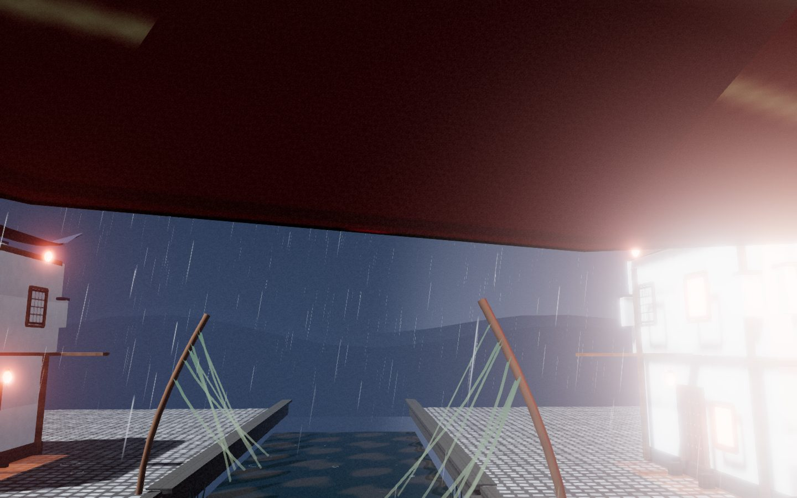
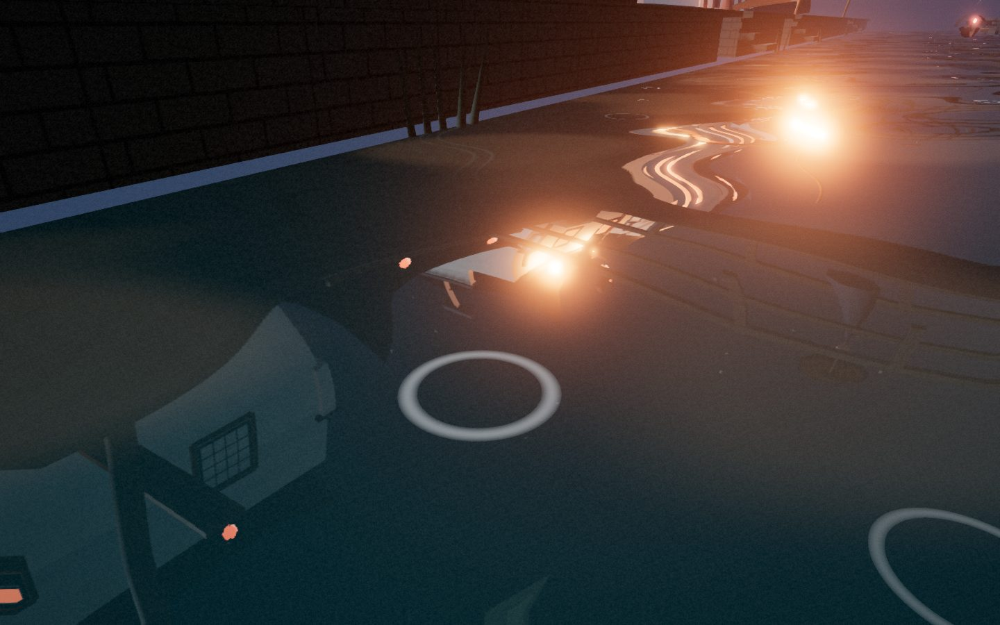
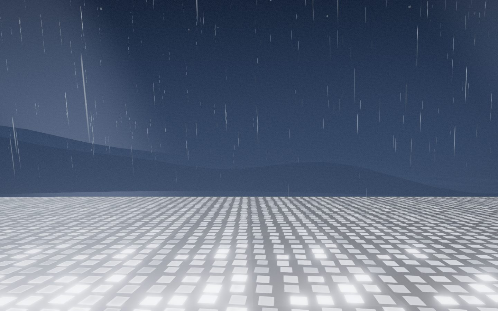
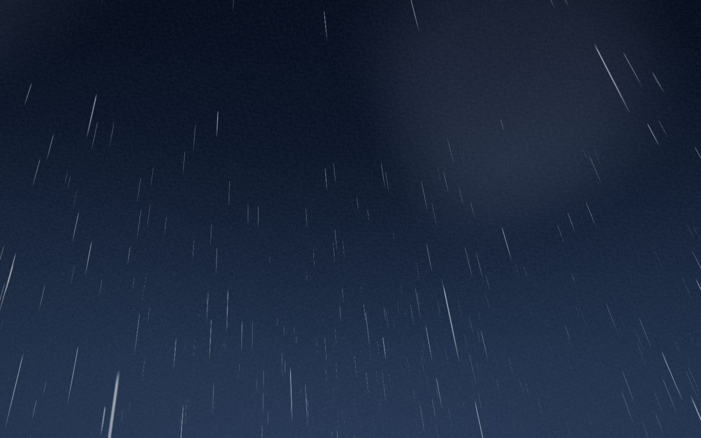
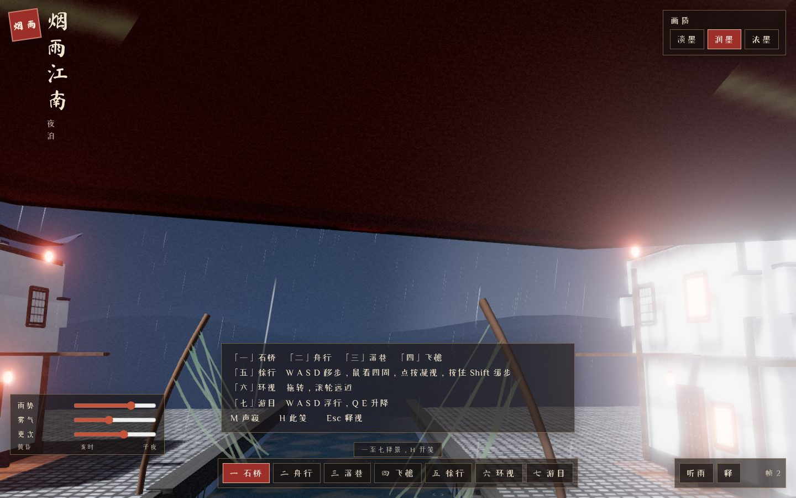

# 烟雨江南 · 夜泊

A browser demo of a Ming–Qing Jiangnan water town on a rainy night. The town is built from procedural geometry, textures, and sound. There are no downloaded models and no paid services.

**Live page (after this lands on `main` and GitHub Pages is enabled):**  
https://connect-world-1985-ai.github.io/2026-10-25-jiangnan-rainy-night-demo-grok47/



## Run it

```bash
npm install
npm run dev
```

Open `http://localhost:5173/2026-10-25-jiangnan-rainy-night-demo-grok47/`. The Vite `base` is the GitHub Pages project path, so the dev server uses that prefix too.

```bash
npm run build
npm run preview
```

## Look

White plaster, black tile roofs, stepped 马头墙 gables, wooden lattice, arched stone bridges, wet flagstones, paper lanterns, 乌篷船, oil-paper umbrellas, and calligraphy on the teahouse. Fog and the grade pass lean toward ink wash. The scene does not include electric lamps, cars, wires, or modern signage.







## Controls

The overlay is written in classical Chinese. Keys:

| Key | View |
| --- | --- |
| 1 | 石桥, bridge |
| 2 | 舟行, boat along the canal |
| 3 | 深巷, alley |
| 4 | 飞檐, rooftops |
| 5 | 徐行, first-person walk |
| 6 | 环视, orbit |
| 7 | 游目, free fly |
| WASD or arrows | Move in walk and fly |
| Mouse | Look while the pointer is locked (walk and fly). Click the picture to lock. Esc releases it. |
| Shift | Slower walk, faster fly |
| Q / E, or Ctrl / Space | Down / up while flying |
| Drag and wheel | Orbit |
| M | Start or mute the rain |
| H | Open the control note |

On a coarse pointer, the left side of the screen is a walk stick and the right side looks around.

**淡墨 / 润墨 / 浓墨** are the low, medium, and high presets. Sliders change rain, fog, and the hour (黄昏, 亥时, 子夜). If the frame rate stays under 30 for about four seconds, the demo drops one preset by itself and says so.



Optional query flags: `shot=bridge|boat|alley|roof|walk|orbit|fly`, `quality=low|medium|high`, `rain`, `fog`, `night` (each 0–1), `t` (start time in seconds), `clean=1` (hide the overlay), `bench=1` (writes `window.__BENCH__` after about eight seconds).

## How it is drawn

- Three.js r186 on WebGL2, through Vite.
- One merged mesh per material for the town, instanced lanterns, and GPU rain streaks that wrap the camera and are discarded inside building boxes.
- One planar reflector on the canal, with ripple distortion and fresnel. Rain, mist, and glow are hidden while that reflection renders.
- Wet streets use a clearcoat material and projected lantern light, not a second reflector.
- Post: bloom, a light ink grade, ACES through `OutputPass`, then FXAA. Low quality turns bloom, FXAA, and shadows off and shortens the rain, the mist, and the reflection target.
- Audio is synthesized in the browser (filtered noise and drips) and starts on a click or on M.

## Performance

Measured in this environment with headless Chrome on SwiftShader (software Vulkan), 1280×720, bridge camera, default rain. There is no GPU here, so these numbers are a floor, not a laptop result.

| Preset | Frames / sec | Draw calls | Triangles |
| --- | --- | --- | --- |
| 淡墨 low | about 9 | 52 | 61k |
| 润墨 medium | about 6 | 79 | 82k |
| 浓墨 high | about 2 | 80 | 90k |

On that same software renderer, leaving the preset on high dropped it to medium after a few seconds and showed 帧缓，已改用淡墨. A machine with a real GPU should sit much higher at the same triangle count. The preset caps are what keep a weaker GPU inside a playable budget: pixel ratio 1 / 1.35 / 1.75, rain 2000 / 5200 / 10000, reflector 320 / 560 / 896, and fewer point lights on the lower presets.

## Limits

- GitHub Pages publishes from `main` via `.github/workflows/pages.yml`. The site URL above stays empty until that workflow has run and Pages is set to GitHub Actions.
- The reflection is one canal plane. Streets are glossy, not mirror-accurate.
- People and boats do not collide with the walker. The walker does stay out of houses and out of the water.
- Touch look is basic. Pointer lock is for a mouse.
- Calligraphy is a subset of Ma Shan Zheng and ZCOOL XiaoWei. The middle dot is not in those fonts, so the document title uses a space.

## Credits

- [Three.js](https://github.com/mrdoob/three.js) r186, MIT. Reflector, postprocessing passes, and controls ship with the library.
- Ma Shan Zheng, Copyright 2018 The Ma Shan Zheng Project Authors, SIL Open Font License 1.1. Subset and license text: `src/assets/fonts/`.
- ZCOOL XiaoWei, Copyright 2018 The ZCOOL XiaoWei Project Authors, SIL Open Font License 1.1. Subset and license text: `src/assets/fonts/`.
- Geometry, textures, rain, and the rain sound are original and generated in the page.
